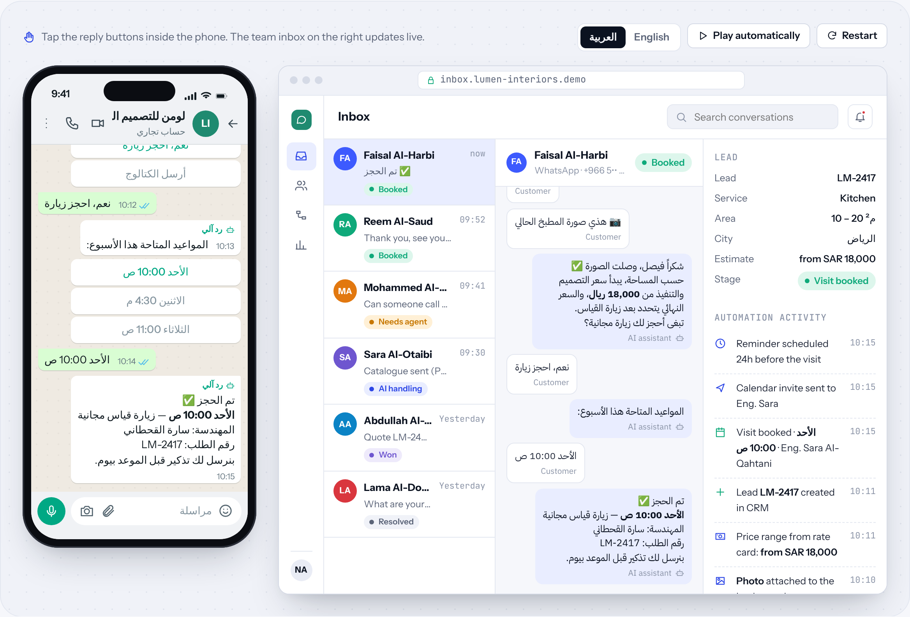
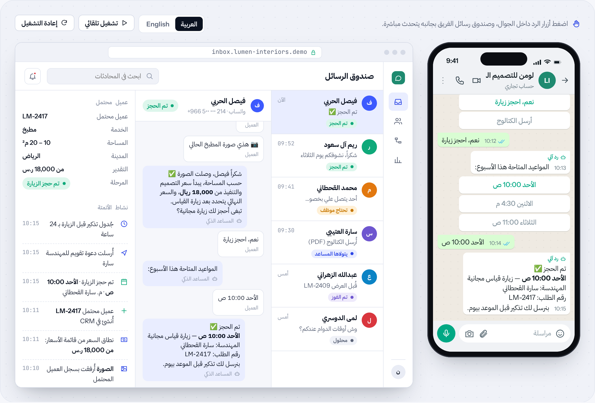

# HUDERA Connect

**WhatsApp AI assistant + team inbox** · WhatsApp & AI assistants · by [HUDERA AI](https://www.linkedin.com/company/hudera)

A WhatsApp assistant that answers customers in Arabic and English, captures leads and books appointments, with a shared team inbox behind it.

**[▶ Try the live demo](https://hudera-ai.github.io/hudera-connect/)** · runs in your browser on sample data · Arabic & English

## The problem
Customers message on WhatsApp at all hours. Questions about prices and availability wait for a person, leads get lost in personal phones, and nobody can see what was promised to whom.

## What it does
An AI assistant on your WhatsApp Business number answers the common questions, collects the details your sales team needs, books visits from real calendar slots, and hands the chat to a person whenever the customer asks.

## Business value
Every inquiry gets an answer and a record. Your team works from one shared inbox instead of personal phones, and managers see where each lead stands.

## Features
| Feature | Details |
| --- | --- |
| Arabic & English | Replies in the customer's language and dialect |
| Lead capture | Fields saved to your CRM as the chat goes |
| Booking | Offers real slots from your team's calendar |
| Human handoff | A person can take over any chat in one click |
| No-code flows | Turn automations on and off without a developer |
| Analytics | Volumes, intents and conversion by day |

## How the workflow runs
**Trigger**: Customer messages → **AI**: Understand intent → **Collect**: Ask & capture → **Act**: Lead + booking → **Team**: Inbox & handoff

## Typical stack
WhatsApp Business Platform · LLM (Arabic & English) · n8n workflows · CRM / Google Calendar · Web dashboard

## Run it locally
Open `index.html` in any modern browser. No build step, no server, no data leaves your machine.

---

## HUDERA Connect بالعربي

**مساعد واتساب ذكي + صندوق رسائل للفريق**

مساعد واتساب يرد على العملاء بالعربي والإنجليزي، ويسجّل العملاء المحتملين ويحجز المواعيد، ومن خلفه صندوق رسائل مشترك للفريق.

### المشكلة
العملاء يراسلون على واتساب في كل الأوقات. أسئلة الأسعار والتوفر تنتظر موظفاً، والعملاء المحتملون يضيعون في الجوالات الشخصية، ولا أحد يعرف ما الذي وُعد به كل عميل.

### ما الذي يفعله
مساعد ذكي على رقم واتساب للأعمال يرد على الأسئلة المتكررة، ويجمع التفاصيل التي يحتاجها فريق المبيعات، ويحجز الزيارات من مواعيد التقويم الفعلية، ويحوّل المحادثة لموظف متى طلب العميل.

### القيمة للأعمال
كل استفسار يحصل على رد وسجل. فريقك يعمل من صندوق رسائل مشترك بدل الجوالات الشخصية، والمدير يرى أين وصل كل عميل محتمل.

### المزايا
| الميزة | التفاصيل |
| --- | --- |
| عربي وإنجليزي | يرد بلغة العميل ولهجته |
| تسجيل العملاء المحتملين | البيانات تُحفظ في نظام CRM أثناء المحادثة |
| الحجز | يعرض مواعيد فعلية من تقويم فريقك |
| التحويل لموظف | يستطيع الموظف استلام أي محادثة بضغطة واحدة |
| مسارات بدون برمجة | شغّل الأتمتة وأوقفها بدون مبرمج |
| التحليلات | الأحجام والنوايا ونسب التحويل يومياً |

### كيف يسير العمل
**المُشغِّل**: رسالة من العميل ← **AI**: فهم الطلب ← **Collect**: السؤال والتسجيل ← **التنفيذ**: عميل محتمل + حجز ← **Team**: صندوق الرسائل والتحويل

---

## About HUDERA AI
HUDERA AI builds WhatsApp AI assistants, business dashboards, workflow automations and custom SaaS products for companies in Saudi Arabia and the Gulf.

- LinkedIn: [linkedin.com/company/hudera](https://www.linkedin.com/company/hudera)
- Email: hudera.ai@gmail.com
- WhatsApp: [+20 155 515 9139](https://wa.me/201555159139)

> This repository is a product demo. Company names, people and figures inside it are fictional sample data.

© 2026 HUDERA AI. All rights reserved.
